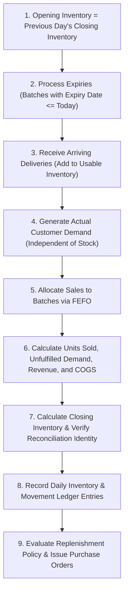

# PharmaPulse — Complete Synthetic Dataset Documentation & Engineering Specification

## 1. Project Purpose & Academic Context

**PharmaPulse** is an end-to-end, machine-learning-powered demand forecasting and inventory risk intelligence system designed for community and hospital pharmacy operations. This synthetic dataset models the complete daily supply chain, dispensing transactions, batch-level expirations, and procurement events for a retail pharmacy branch over a 3-year timeline.

The dataset serves as the foundational data infrastructure for four core predictive modules:
1. **Demand Forecasting Module**: Multi-horizon time-series forecasting of daily pharmaceutical customer demand.
2. **Expiry Risk Prediction Module**: Pre-expiry classification and regression predicting unsold stock at 30, 14, and 7 days prior to batch expiration.
3. **Stockout Prediction Module**: Supervised classification predicting whether usable inventory will be exhausted during vendor replenishment lead time.
4. **Medicine Sales Behaviour Clustering Module**: Unsupervised behavioral SKU clustering for automated inventory policy segmentation.

---

## 2. Synthetic Data Disclaimer & Ethical Notice

> [!NOTE]
> **Synthetic Data Disclaimer**: All records in this repository are artificially generated via stochastic simulation models for academic research, education, and algorithmic benchmarking. They do **NOT** represent actual patient records, medical records, or confidential commercial data from any licensed pharmacy, hospital, distributor, or pharmaceutical manufacturer. All prices are illustrative PKR values and should not be used as real-world market pricing references.

---

## 3. Fixed Simulation Parameters & Architectural Assumptions

| Parameter | Specification | Verification Outcome |
|---|---|---|
| **Pharmacy Scope** | Single pharmacy, single retail branch | Confirmed |
| **Medicines / SKUs** | Exactly 150 unique medicines | 150 medicines verified (`MED001`–`MED150`) |
| **Categories** | Exactly 6 therapeutic categories | 6 categories verified (`CAT001`–`CAT006`) |
| **Suppliers** | Exactly 10 regional pharmaceutical distributors | 10 suppliers verified (`SUP001`–`SUP010`) |
| **Simulation Period** | 2024-01-01 to 2026-12-30 | Exactly 1,095 consecutive calendar days |
| **Total Medicine-Days** | 150 medicines × 1,095 days = 164,250 | Exactly 164,250 rows |
| **Inventory Tracking** | Physical batch-level tracking with expiry dates | Batch granularity verified |
| **Dispensing Policy** | FEFO (First Expiry, First Out) | Strictly enforced |
| **Replenishment Policy** | Reorder Point $(s, S)$ with Lead Time & Reliability | Deterministic policy enforced |
| **Random Seed** | 42 | Fully reproducible |
| **Currency** | Pakistani Rupee (PKR) | Consistent illustrative values |
| **Storage Format** | Comma-Separated Values (CSV) | Standard UTF-8 CSVs |

---

## 4. Master Data Architecture & Distributions

### 4.1 Therapeutic Categories (`categories.csv` & `medicines.csv`)

The 150 medicines are distributed across six therapeutic categories matching the exact project specification:

| Category ID | Category Name | Medicine Count | Example Generics / Brands |
|---|---|---:|---|
| `CAT001` | Pain relief and fever | 30 | Paracetamol (Panadol, Calpol), Ibuprofen (Brufen), Mefenamic Acid (Ponstan), Diclofenac (Voltral) |
| `CAT002` | Anti-infectives | 25 | Amoxicillin-Clavulanate (Augmentin), Azithromycin (Zithromax), Cefixime (Cefspan), Metronidazole (Flagyl) |
| `CAT003` | Respiratory and cold | 25 | Cetirizine (Zyrtec), Salbutamol (Ventolin), Montelukast (Singulair), Fluticasone (Avamys), Cough Syrups |
| `CAT004` | Gastrointestinal | 20 | Omeprazole (Risek), Esomeprazole (Nexum), Pantoprazole (Controloc), Domperidone (Motilium), ORS |
| `CAT005` | Chronic care | 25 | Metformin (Glucophage), Bisoprolol (Concor), Amlodipine (Norvasc), Valsartan (Diovan), Atorvastatin (Lipitor) |
| `CAT006` | Vitamins and supplements | 25 | Multivitamins (Surbex Z, Centrum), Calcium + Vit D (CaC-1000, Osnate-D), Mecobalamin (Methycobal) |
| **Total** | | **150** | |

### 4.2 Demand Pattern Distribution

Each medicine was configured in the simulator with an underlying stochastic demand regime:

| Demand Pattern | SKU Count | Behavioral Profile |
|---|---:|---|
| **Consistent** | 40 | Low dispersion, stable daily demand, minor weekend effect |
| **Seasonal** | 35 | Strong winter peak (respiratory/fever) or summer peak (gastro/hydration) |
| **Growing** | 25 | Upward trajectory over the 3-year period (+50% to +70%) |
| **Declining** | 20 | Downward trend over the 3-year period (-35% to -50%) |
| **Irregular** | 30 | High zero-demand probability (30% days = 0) with intermittent demand bursts |
| **Total** | **150** | |

> [!IMPORTANT]
> `demand_pattern` is a simulator configuration attribute. It is strictly **excluded** from all clustering features and predictive model feature sets to prevent label contamination.

### 4.3 Suppliers & Commercial Contracts (`suppliers.csv` & `medicine_suppliers.csv`)

- **10 Suppliers (`SUP001`–`SUP010`)** distributed across major logistics hubs (Karachi, Lahore, Islamabad, Rawalpindi, Faisalabad, Peshawar, Multan, Hyderabad, Quetta, Gujranwala).
- **Lead times**: Ranging from 4 to 18 days.
- **Delivery reliability**: Ranging from 86% to 98%.
- **Contract Mapping**: Every medicine has exactly **1 preferred supplier** (`is_preferred_supplier = 1`) and 1 to 2 secondary backup suppliers.

---

## 5. Daily Simulation Engine Lifecycle

Every simulated day $t \in [1, 1095]$, for each medicine $m \in [1, 150]$, events are processed in this exact, deterministic sequence:



### 5.1 Expiry Processing Convention
A batch expiring on date $D$ is deemed expired at the **start of day $D$** before sales occur. Remaining units are deducted from usable stock, batch status is set to `EXPIRED`, and logged as an `expiry` movement on date $D$. Units cannot be sold on or after their expiry date.

### 5.2 Delivery Processing
Orders scheduled to arrive on date $D$ are received before daily sales, increasing usable inventory and logging a `purchase_receipt` movement.

### 5.3 Demand Model (Count-Based Negative Binomial)
Demand is generated strictly independently of available inventory:
$$\lambda_{m,t} = \text{base\_demand}_m \times \text{dow\_factor}_{m, \text{dow}} \times \text{season\_factor}_{m, \text{month}} \times \text{trend\_factor}_{m, t} \times \text{spike\_factor}_{m, t}$$
Actual demand is sampled from a Negative Binomial distribution with mean $\lambda_{m,t}$ and variance $\lambda_{m,t} + \alpha \lambda_{m,t}^2$.

### 5.4 FEFO Dispensing Logic
Usable batches are sorted by `expiry_date ASC, received_date ASC`. Customer demand is dispensed sequentially from the earliest expiring batch. Depleted batches are marked `DEPLETED`.

### 5.5 Inventory Conservation & Reconciliation Identity
Closing inventory strictly adheres to the physical conservation law:
$$\text{ClosingStock}(t) = \text{OpeningStock}(t) + \text{ReceivedQuantity}(t) - \text{ExpiredQuantity}(t) - \text{UnitsSold}(t)$$
$$\text{OpeningStock}(t+1) = \text{ClosingStock}(t)$$
Reconciliation discrepancies across all 164,250 medicine-days equal **zero**.

### 5.6 Replenishment Policy
Pipeline inventory = $\text{ClosingStock} + \sum \text{Pending PO Quantities}$.
If $\text{PipelineInventory} \le \text{reorder\_level}_m$:
- Order quantity calculated to bring coverage up to `target_stock_days`.
- Preferred supplier assigned.
- Supplier reliability sampled to simulate on-time delivery or logistical delay.
- Orders arriving before simulation end are received upon arrival; orders arriving after 2026-12-30 remain `PENDING`.

---

## 6. Raw Datasets Reference (`data/raw/`)

| File Name | Row Count | Primary Key | Description & Grain |
|---|---:|---|---|
| `categories.csv` | 6 | `category_id` | 6 clinical categories with descriptions |
| `medicines.csv` | 150 | `medicine_id` | 150 medicines with pricing, clinical form, and thresholds |
| `suppliers.csv` | 10 | `supplier_id` | 10 distributors with lead times and reliabilities |
| `medicine_suppliers.csv` | 376 | `medicine_supplier_id` | Contracts mapping medicines to preferred and backup vendors |
| `batches.csv` | 9,567 | `batch_id` | Physical batch records with received date, expiry date, initial qty |
| `purchase_orders.csv` | 9,654 | `purchase_order_id` | All replenishment purchase orders (9,567 delivered, 87 pending) |
| `deliveries.csv` | 9,567 | `delivery_id` | Completed receipts linked 1:1 with delivered batches and POs |
| `daily_demand_sales.csv` | 164,250 | `(date, medicine_id)` | Daily unconstrained demand, sales, revenue, and COGS |
| `daily_inventory.csv` | 164,250 | `(date, medicine_id)` | Opening, received, expired, sold, closing stock, and stockout flag |
| `inventory_movements.csv` | 170,202 | `movement_id` | Transaction ledger (`opening_balance`, `purchase_receipt`, `sale`, `expiry`) |

---

## 7. Machine-Learning Datasets Reference (`data/processed/`)

### 7.1 Demand Forecasting (`forecasting_features.csv`)
- **Grain**: One row per medicine per calendar day (164,250 rows).
- **Target**: `actual_demand` (integer count).
- **Features**:
  - Calendar: `day_of_week`, `day_of_month`, `month`, `quarter`, `is_weekend`.
  - Shifted Lags: `lag_1`, `lag_7`, `lag_14`, `lag_28` (strictly past observations).
  - Shifted Rolling Windows: `rolling_mean_7`, `rolling_mean_14`, `rolling_mean_28`, `rolling_std_7`, `rolling_std_28`.
- **Temporal Leakage Prevention**: All rolling windows are calculated on shifted demand (`demand.shift(1)`), ensuring the target date is never included in its own predictors.

### 7.2 Expiry Risk Prediction
- **Final Batch Outcome Table (`expiry_model_data.csv`)**: 9,567 rows (one per batch). Tracks total initial quantity, cumulative sales, unsold units at expiry, and outcome status (`EXPIRED`, `DEPLETED`, or `ACTIVE_AT_SIMULATION_END`).
- **Predictive Expiry Snapshots (`expiry_prediction_snapshots.csv`)**: 955 rows.
  - **Grain**: One row per active batch snapshot evaluated at **30, 14, and 7 days before batch expiry**.
  - **Features**: `remaining_batch_quantity`, `historical_medicine_demand_7d/14d/30d`, `historical_sales_7d/14d/30d`, `stock_coverage_estimate`, `batch_age_days`.
  - **Targets**:
    - Regression: `target_unsold_quantity`.
    - Binary: `target_unsold_flag` (1 if unsold units > 0, else 0).
    - Multi-Class Classification: `target_expiry_risk_class`:
      - **Low**: Unsold percentage < 5% (878 snapshots)
      - **Medium**: 5% to < 15% (27 snapshots)
      - **High**: 15% to < 30% (30 snapshots)
      - **Critical**: $\ge 30\%$ (15 snapshots)
      - **NaN (Censored)**: Active batches expiring after simulation end (5 snapshots)
  - **Non-Leakage Guarantee**: Snapshots are created only if the batch was already received and still had usable stock on or before `snapshot_date`. Batches whose expiry falls beyond simulation end have unknown (null) targets.

### 7.3 Stockout Prediction (`stockout_prediction_data.csv`)
- **Grain**: One row per purchase order replenishment event ($order\_date \ge 2024-01-01$, 9,345 rows).
- **Target**: `target_stockout_before_arrival` (1 if usable inventory drops to 0 strictly between `order_date` and `actual_delivery_date`; 0 if delivered without stockout; `null` for pending orders).
  - Target 0.0: 7,410 orders (~79.3%)
  - Target 1.0: 1,848 orders (~19.8% stockout rate)
  - Target NaN: 87 pending orders
- **Features**: Strictly available at PO creation time: `usable_stock_at_order`, `outstanding_order_quantity_at_order`, `historical_demand_7d/14d/30d`, `average_daily_demand_7d/30d`, `demand_std_30d`, `reorder_level`, `target_stock_days`, `supplier_lead_time_days`, `supplier_reliability`, `days_until_expected_delivery`.
- **Non-Leakage Guarantee**: Actual delivery date and delivery delays are strictly excluded from predictors. Pending orders with incomplete observation windows are censored with NaN targets.

### 7.4 Medicine Sales Behaviour Clustering (`clustering_features.csv`)
- **Grain**: Exactly 150 rows (one per medicine).
- **Features**: `average_daily_demand`, `demand_std`, `demand_coefficient_of_variation`, `average_monthly_demand`, `total_units_sold`, `sales_frequency`, `zero_demand_day_ratio`, `demand_trend`, `seasonal_strength`, `average_daily_sales`, `stockout_day_ratio`, `unfulfilled_demand_ratio`.
- **Integrity**: `medicine_name`, `brand_name`, `supplier_name`, and `demand_pattern` are strictly excluded from clustering features.

---

## 8. Data Splitting & Leakage Prevention Strategy

To prevent data snooping and temporal leakage during subsequent model training:

### 8.1 Chronological Split for Demand Forecasting
The 1,095 days must be partitioned chronologically:
- **Training Set (70%)**: Days 1 to 766 (`2024-01-01` to `2026-02-05`) — 114,900 rows.
- **Validation Set (15%)**: Days 767 to 930 (`2026-02-06` to `2026-07-19`) — 24,600 rows.
- **Test Set (15%)**: Days 931 to 1095 (`2026-07-20` to `2026-12-30`) — 24,750 rows.
- *Rule*: Never randomly shuffle date rows.

### 8.2 Grouped Split for Expiry Risk Prediction
- Group snapshots by `batch_id`.
- Ensure all snapshots (30d, 14d, 7d) from the same batch reside entirely within either Train, Validation, or Test. Never split snapshots of the same batch across sets.

### 8.3 Chronological Order Split for Stockout Prediction
- Split PO events chronologically based on `order_date`.
- Exclude pending orders (`target_stockout_before_arrival = NaN`) from supervised model fitting.

### 8.4 Preprocessing Isolation
- Scalers, imputers, and normalizers must be fit exclusively on the Training split and applied transform-only to Validation and Test splits.

---

## 9. Validation Report Summary

The automated validation suite (`scripts/validate_datasets.py`) verified 100% of data integrity checks:

- **Overall Status**: **PASS**
- **Foreign Key Failures**: **0** across all 21 relationships
- **Inventory Reconciliation Failures**: **0** across all 164,250 medicine-days
- **Daily Inventory Continuity Discrepancies**: **0** across all 150 medicines
- **Batch Oversold Discrepancies**: **0** (no batch sold more units than initial received)
- **Temporal Leakage Failures**: **0**
- **Unintended Duplicate Rows**: **0**

---

## 10. Reproduction & Dataset Regeneration Instructions

To reproduce the entire dataset from scratch using the deterministic seed (`42`):

```bash
# 1. Generate master catalog (categories, suppliers, medicines, contracts)
python scripts/generate_master_data.py

# 2. Run the 1,095-day pharmacy simulation engine
python scripts/simulate_pharmacy.py

# 3. Build all four machine-learning ready datasets
python scripts/build_ml_datasets.py

# 4. Generate the complete data dictionary
python scripts/generate_data_dictionary.py

# 5. Run the global quality and reconciliation validation engine
python scripts/validate_datasets.py
```

All generated files will be written to `data/raw/`, `data/processed/`, and `data/outputs/`.
